
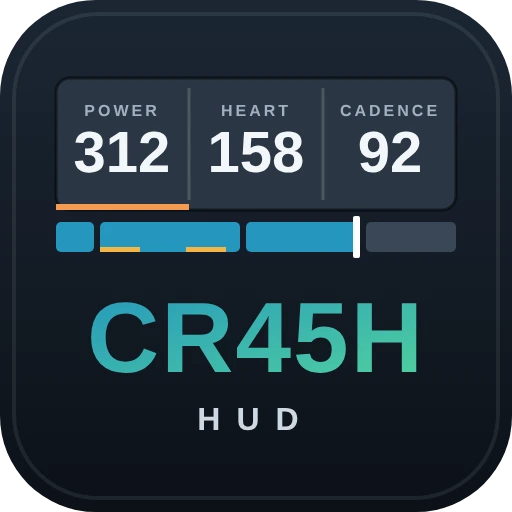

# CR45H HUD

Two overlay windows for Sauce for Zwift, made by **cr45hmurphy**. They share one look and work on their own or together.

| Window | What it is |
|---|---|
| **Metric HUD** | Your ride numbers (power, heart rate, cadence, speed and more) in a layout you choose. |
| **Ride Progress Bar** | How far along the route you are, with segment markers and the next segment. It can also sit inside the Metric HUD. |

Everything it needs comes with Sauce. There is nothing else to download, no account, and no internet access needed.

## Install

1. Unzip it so you end up with `Documents/SauceMods/cr45h-hud/manifest.json`. If you have no SauceMods folder, create one. ("Documents" may be called "My Documents".)
2. **Fully quit Sauce, including from the system tray, and start it again.** Sauce keeps mod code loaded, so refreshing a window is not enough. This applies to every update, too.
3. In Sauce, open **Mods** and enable **CR45H HUD**.
4. From Sauce's window menu, add **Metric HUD** and **Ride Progress Bar**.

Right-click a window for its controls. The gear opens its settings.

## Good to know

- **Text size is a setting.** It does not follow the window size, so resize the window to fit your text. In the Metric HUD it sizes the metrics; a docked progress bar has its own size.
- **Taller windows.** The Metric HUD needs more height when rows wrap or a progress bar is docked.
- **Power-up needs Game Connection.** Turn it on in Sauce's own settings (General).

---

## Metric HUD

### Metrics

Pick which metrics to show, and their order, in the **Metrics** list at the bottom of the settings.

| Metric | Shows |
|---|---|
| Power | Watts. Colored by your power zone. |
| Heart rate | Beats per minute. |
| Cadence | Revolutions per minute. |
| Speed | Km/h or mph. |
| Distance | Distance ridden. |
| Ride time | Time on the clock. |
| Elevation | Meters or feet climbed. |
| Grade | Current gradient, in percent. |
| Power / weight | Watts per kilogram. |
| Power-up | Icon of the power-up you are holding (see below). |

### Look

Two settings that combine freely: **Layout** is how a metric is arranged inside its cell, **Surface** is what is drawn behind the metrics.

| Setting | Options |
|---|---|
| **Layout** | **Stacked**: label above the number (the default). **Inline**: label, number and unit on one line; slim, no second line. **Side**: a big number with the label and unit beside it. |
| **Surface** | **Plate**: one slab with thin dividers (the default). **Cards**: a box per metric. **Open**: nothing drawn, no surface and no lines; text gets the outline setting instead. |
| **Labels** | Text, icons, or none. |
| **Surface opacity** | How see-through the plate or cards are. |
| **Corners** | Square, slightly rounded, or rounded. For the plate or cards only. The docked progress bar has its own Corners setting. |
| **Text outline** | None, light, medium or heavy. A dark edge that keeps text readable over bright scenery. |
| **Zone color** | Power takes the color of your current power zone: a stripe under the number, or the number itself. Uses your FTP from Zwift. |

Every cell in a row is the same height, with the label at the top and the number at the bottom. Every normal cell is one unit wide, on both sides of a split.

**Layout and surface.** All nine combinations, with the default Square corners and second lines on.

*Stacked*

Plate: 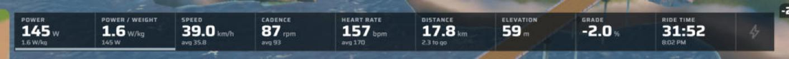

Cards: 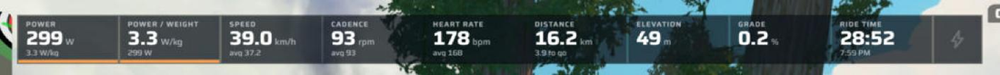

Open: 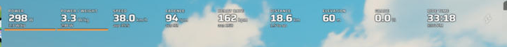

*Inline (two rows of five here, because ten metrics do not fit one row in this window)*

Plate: 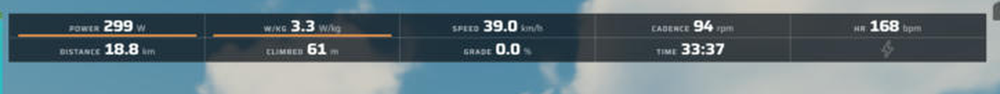

Cards: 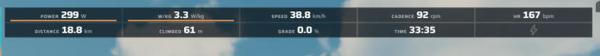

Open: 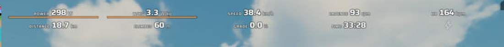

*Side*

Plate: 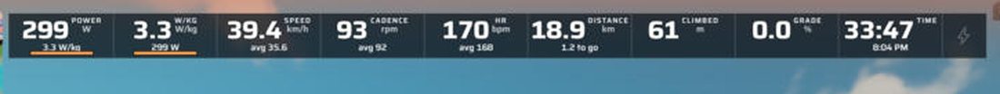

Cards: 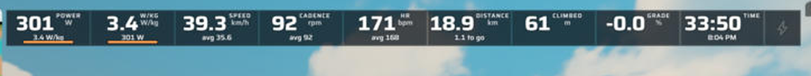

Open: 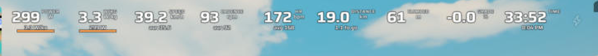

**Labels, zone color and corners.**

Icons instead of text labels: 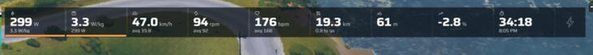

No labels: 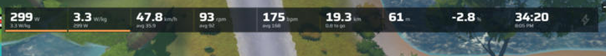

Zone color on the number: 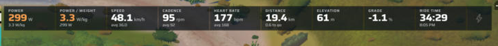

Rounded corners: 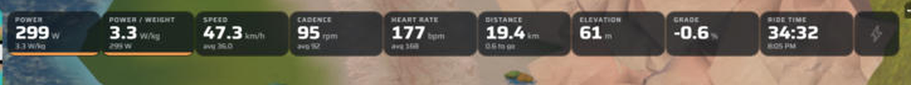

### Second lines

A small second line under a metric. One switch turns them all off; each metric also has its own switch.

On: 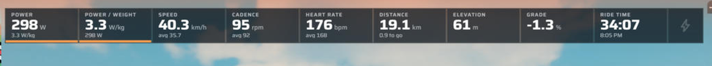

Off (master switch): 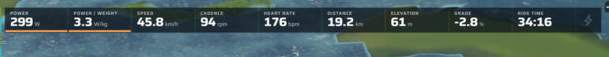

| Metric | Shows | Default |
|---|---|---|
| **Power** | Watts per kilogram. | On |
| **W/kg** | The watts. | On |
| **Heart rate, Cadence, Speed** | This ride's average. | Off |
| **Distance** | What is left of your route or event ("to go"). | On |
| **Ride time** | The time of day (clock time). | On |

### Arrangement

| Arrangement | Result |
|---|---|
| One row | All metrics in a line. |
| Rows | A fixed number of metrics per row. |
| Column | A vertical stack for a screen edge. |

Options that combine with them:

| Option | Works with | Result |
|---|---|---|
| **Grouping: two groups with a gap** | One row | Choose which metric the gap comes after. |
| **Grouping: split to the window edges** | One row | Two groups pushed to the left and right edges, leaving the middle clear. |
| **First metric large** | All | The first metric in your list becomes a wider box, **Large size** units wide (1 to 3), with a bigger number and unit. Its label, second line and height match the other cells. A Power-up cell never takes this slot; the large box goes to the first real metric. |

When a window is too narrow, rows split on their own instead of squeezing the numbers. Groups stack when they no longer fit side by side.

First metric large: 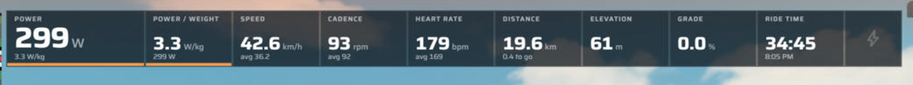

Two groups with a gap, first metric large: 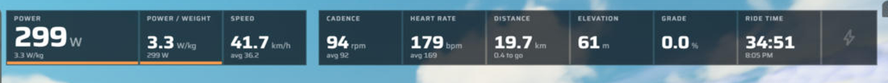

Split to the window edges: 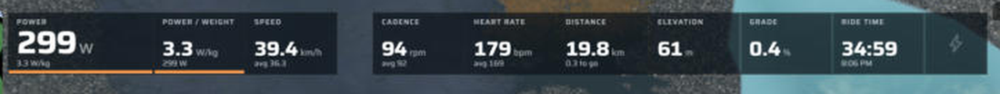

### Power-up

The Power-up cell shows only the icon, in a square as tall as the row.

| State | What you see |
|---|---|
| Holding one | Its icon. |
| Using one | Its icon with a green outline. |
| Nothing held | A dim bolt. |
| No Game Connection | A dim bolt. |

The **Power-up name** setting adds the name beside the icon, plus the seconds left while it is active.

### Progress bar

Show the Ride Progress Bar **above** or **below** the metrics, or keep it **off**. A docked bar has every setting the standalone window has (see below), plus its own **Progress bar text size**, so it can be sized separately from the metrics.

---

## Ride Progress Bar

Shows how far along the current route you are, with the lead-in, the segments ahead and the next segment.

### Bar

| Setting | Options |
|---|---|
| **Style** | **Full bar**. **Compact bar**: one row, labels inside the bar. **Thin line**. |
| **Line layout** | For the thin line. **Line only**: no labels. **Labels beside** the line. **Labels on their own row**. **Raised segment markers**. |
| **Minimum bar height** | The bar grows if its text needs more room. |
| **Corners** | Square, slightly rounded, or rounded. |
| **Your position** | A bar, a notch (arrow above), or none. |
| **Show lead-in** | The hatched section before the route starts, or the connector between laps. |

### Labels

| Setting | Options |
|---|---|
| **Left, middle and right label** | Each one: Route name, Next segment, Lap, or Nothing. |
| **Label row** | Above the bar, below it, or split (left label above, right label below). |
| **Swap route name for next segment** | When a segment is close, or while you ride one, a Route name label shows the next segment instead. You choose how close. |
| **Progress readout** | Distance left, percent complete, both, or nothing. Always at the far right. |
| **Text outline** | None, light, medium or heavy. |

### Segments

| Setting | Options |
|---|---|
| **Segment markers** | Colored marks where segments start and end. |
| **Marker colors** | Zwift colors, lighter, or colorblind-friendly. Sprints are green, climbs red, loops orange. |
| **Include loops** | Loop segments often cover a whole lap, so you can hide them. |
| **Highlight upcoming segment** | The next-segment label pulses in the last 500 m, turns solid while you ride the segment, and its marker brightens. |
| **Next segment shows** | Its type (Sprint, Climb, Loop) or its full name. |
| **Next segment color** | The segment's color, or white. |

---

## Known limits

- **Window height.** The window does not resize itself to its content. Rows, Column and a docked progress bar need a taller window than one row does; if the window is too short, the lower rows are cut off. Drag the window taller.
- **Laps and events.** The progress bar covers the current lap, not a whole multi-lap event. In an event, the Lap label shows the lap count when Sauce provides it. Events and the "to go" lines have not been tried in a real event yet.
- **Segment types.** Sprint, climb and loop come from each segment's name and its loop flag. A few unnamed ones are listed by hand, and anything unrecognized shows as Segment.
- **Power-up.** Built from how Sauce's own PowerUp field works. It has not been tried with a real power-up yet.
- **Sauce version.** Built and tried on Sauce for Zwift 2.4.x. Other versions may differ.

## Feedback

Found a problem? Tell cr45hmurphy which window and settings you were using, what you expected, and what happened. A screenshot helps.

## Development

- Tests: `node --test tests/`
- Build a test package: `python package.py` (writes `dist/cr45h-hud-<version>.zip` and checks it).
- The repository also has Focus Dashboard, Metric Clusters and Power Zone Bar windows that have not had a design pass yet. They are not in the test package.
- History: `CHANGELOG.md`. Early mockups: `design-history/`.
